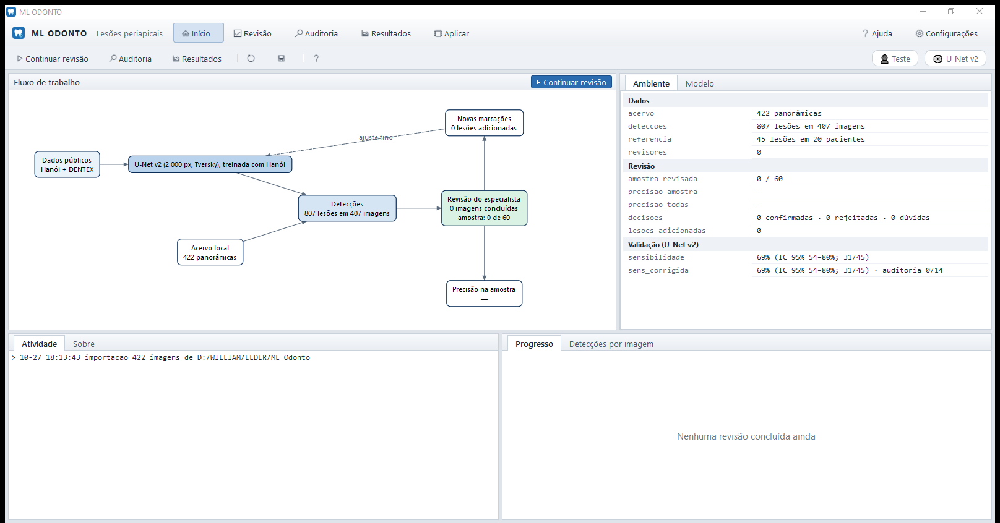
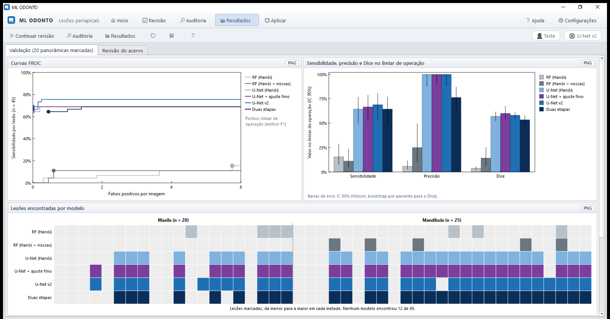

<div align="center">


# ML ODONTO

**Detecção de lesões periapicais em radiografias panorâmicas, com revisão por especialistas**

Rede neural treinada só com dados públicos · programa para Windows que roda sem internet · validação lesão a lesão

[](https://github.com/williamjot/ML-ODONTO/actions/workflows/cpp.yml)


</div>

<div align="center"></div>

O **ML ODONTO** marca nas panorâmicas as lesões periapicais que uma rede neural (U-Net v2) encontrou e pede o
julgamento do dentista: confirmar, rejeitar, marcar dúvida e desenhar o que a rede deixou passar. As respostas
medem quanto a rede acerta de verdade no acervo do serviço e geram os exemplos para melhorá-la.

O programa **apoia a leitura e não substitui o diagnóstico**. Todas as radiografias ficam no computador.

## Sumário

- [Para a equipe: começar a usar](#para-a-equipe-começar-a-usar)
- [O programa](#o-programa)
- [Resultados da pesquisa](#resultados-da-pesquisa)
- [Como funciona](#como-funciona)
- [Para quem mantém o código](#para-quem-mantém-o-código)
- [Dados, privacidade e ética](#dados-privacidade-e-ética)
- [Licença e créditos](#licença-e-créditos)

---

## Para a equipe: começar a usar

**Requisitos:** Windows 10 ou 11 (64 bits) e 8 GB de memória. Não é preciso instalar R, Python nem nada além.

1. **Receba a pasta `ML ODONTO`** (cerca de 150 MB, com o programa e o modelo) do responsável pelo projeto e
   copie-a para o computador, por exemplo em `C:\ML ODONTO`. Ela não fica no repositório: é montada a partir
   do código e dos pesos do modelo, como descrito [mais abaixo](#montar-o-programa).
2. **Dê dois cliques em `ML ODONTO.exe`.** Na primeira vez, o Windows pode mostrar *“O Windows protegeu o
   computador”*, porque o programa não tem assinatura digital comercial: clique em **Mais informações** ›
   **Executar assim mesmo**. Para ter um atalho, clique com o botão direito no arquivo › *Enviar para* ›
   *Área de trabalho*.
3. **Escreva o seu nome** quando o programa pedir. Cada revisor tem as próprias respostas.
4. **Abra a tela Ajuda.** O [manual do dentista](docs/MANUAL_DENTISTA.md) está lá em versão interativa, com
   um simulador da revisão para treinar as teclas antes de começar. Em resumo: comece pelas 60 imagens da
   *amostra aleatória*, olhe primeiro sem as marcações (**H**), decida cada detecção (**1** confirma, **2**
   rejeita, **3** dúvida) e desenhe com **M** as lesões que o programa não marcou.

### Onde ficam os dados, e o que isso implica

| Assunto | Como funciona |
|---|---|
| Pasta dos dados | `Documentos\OdontoLesao`: o banco de dados, cópias reduzidas das imagens e os backups |
| Gravação | cada clique é gravado na hora; não existe botão Salvar |
| Backup | uma cópia completa do banco por dia, as sete mais recentes, em `OdontoLesao\backups`; *Configurações › Fazer backup agora* faz uma extra |
| Vários revisores | cada pessoa usa o próprio nome. A concordância entre revisores (kappa) só é calculada entre revisões **do mesmo banco**: para compará-las, revisem no mesmo computador, cada um com seu nome |
| Levar a outro computador | copie a pasta `OdontoLesao` inteira com o programa fechado |
| Pastas sincronizadas | não deixe o banco numa pasta de rede ou sincronizada por OneDrive/Google Drive enquanto o programa está aberto: a sincronização pode corromper o banco. Se `Documentos` for sincronizado, avise o responsável técnico |

## O programa

| Tela | Para quê |
|---|---|
| **Início** | O fluxo de trabalho com os números de hoje; precisão na amostra com intervalo de confiança; registro de atividades; progresso da revisão |
| **Revisão** | Visor com zoom, contraste, brilho e modo cego; confirmar, rejeitar ou marcar dúvida em cada detecção; desenhar lesões não detectadas; imagem inadequada e observações |
| **Auditoria** | Cada lesão marcada por especialista que o modelo não encontrou, com a panorâmica, a região ampliada, o traço e o mapa de probabilidade, para julgar se ela é visível |
| **Resultados** | Curvas FROC, sensibilidade, precisão e Dice com IC 95%, mapa das 45 lesões de referência, sensibilidade corrigida pela auditoria, concordância entre revisores; gráficos em PNG |
| **Aplicar** | Roda a U-Net v2 em novas radiografias (JPG, PNG, TIFF, BMP), cerca de 11 s cada, em segundo plano; as detecções entram direto na fila de revisão; exporta CSV |
| **Ajuda** | O manual interativo do dentista |
| **Configurações** | Nome do revisor, modo cego, pasta dos dados e backup |

<div align="center"></div>

## Resultados da pesquisa

Um serviço com **apenas 20 panorâmicas com lesões contornadas por especialista (45 lesões)** e **422
panorâmicas sem marcação** consegue um detector útil? Os modelos foram treinados só com dados públicos
(3.920 panorâmicas de Hanói com lesões em caixas; 634 do DENTEX com os dentes numerados e 705 com
diagnósticos) e avaliados nas radiografias locais, que nunca saíram do computador. Na validação, cada paciente
é avaliado por um modelo que não o viu; uma lesão conta como encontrada quando alguma região prevista cobre ao
menos 20% dela.

| Modelo | Sensibilidade com ≤ 0,5 FP/imagem | Sensibilidade no limiar | Precisão | FP/imagem | Dice |
|---|---|---|---|---|---|
| Random Forest por pixel (só Hanói) | 4% | 16% | 6% | 5,8 | 0,04 |
| U-Net v1 (1.400 px) | 69% | 64% | 100% | 0 | 0,57 |
| **U-Net v2 (2.000 px, perda de Tversky)** | **76%** | **69%** (IC 95% 54–80%) | **100%** | **0** | 0,58 |
| U-Net v2 + ajuste fino local | 71% | 67% | 97% | 0,1 | 0,62 |
| Duas etapas (ápices do DENTEX + recortes) | 64% | 64% | 76% | 0,5 | 0,53 |

- A **U-Net v2**, usada no programa, encontrou **31 das 45 lesões sem nenhum falso positivo** e 34 com até
  0,5 falso positivo por imagem.
- **13 das 45 lesões não foram encontradas por nenhum modelo**: são pequenas e, na maioria, maxilares. Os
  testes indicam que o limite é a falta desse tipo de lesão nos dados de treino, não a arquitetura nem a
  resolução, e é por isso que as lesões desenhadas na revisão são o dado mais valioso.
- Aplicada às 422 panorâmicas do acervo, a U-Net v2 marcou 807 lesões em 407 imagens. A precisão nesse
  acervo é o que a revisão da amostra aleatória vai medir.

<div align="center"></div>

## Como funciona

<div align="center"></div>

1. **Pré-processamento:** a radiografia é reduzida por área para 2.000 px de largura e equalizada por CLAHE
   (blocos 8 × 8, limite 2,0).
2. **Rede:** U-Net com codificador ResNet34; a probabilidade é a média da imagem e da sua versão espelhada.
3. **Detecção:** a probabilidade, reduzida a 1.400 px, é suavizada; cada máximo local acima de 0,05 é uma
   candidata, e a região dela é o que passa de metade do pico. No limiar de operação (0,5) ficam as lesões.
4. **Revisão:** cada detecção vira um contorno numerado na tela Revisão; as decisões e as lesões desenhadas
   ficam no banco, e as métricas se atualizam.

O treino foi feito em Python (PyTorch, Google Colab, só dados públicos). O programa reimplementa as etapas
1 a 3 em C++ com ONNX Runtime e reproduz o Python **lesão a lesão** nas 20 panorâmicas: as mesmas 31 de 45,
0 falso positivo, correlação das probabilidades ≥ 0,998
([`docs/EQUIVALENCIA_CPP.md`](docs/EQUIVALENCIA_CPP.md)).

## Para quem mantém o código

### Estrutura

```
ML-ODONTO/
├── cpp/                          programa nativo (C++20, Qt 6, ONNX Runtime)
│   ├── desktop/src/              janela, telas (pages/), banco, métricas, gráficos, visor
│   ├── desktop/tests/            testes do programa (mesmos cenários dos testes R)
│   ├── include/, src/            núcleo: pré-processamento, rede, detecção, linha de comando
│   ├── tests/                    testes do núcleo
│   ├── app/                      ícone, manifesto e versão do .exe
│   ├── third_party/stb/          leitura e gravação de PNG e JPEG (domínio público)
│   └── tools/                    montagem, exportação ONNX e validação
├── software/odontolesao/         versão em R do programa (Shiny), implementação de referência
│   ├── inst/sql/                 migrações do banco, usadas também pelo programa nativo
│   ├── inst/manuais/             manual do dentista (HTML interativo e Markdown), usado pelos dois
│   └── inst/modelos/             registro dos modelos; os pesos ficam fora do repositório
├── scripts/                      pipeline de pesquisa em Python: extração, treino, avaliação, figuras
├── colab/                        notebooks de treino no Google Colab, gerados pelos scripts
├── figuras_R/                    figuras quantitativas em R
├── docs/                         manual, auditoria, equivalências, migração, plano do software
├── Resultados/, Modelos/         resumos e métricas (os dados de pacientes ficam fora)
├── Externos/LEIAME.md            como obter os conjuntos públicos
└── .github/workflows/cpp.yml     integração contínua
```

Ficam **fora do repositório**, pelo `.gitignore`: as radiografias e marcações de pacientes (`Dados/`, `HUB/`,
`Treinamento/`, respostas em `Revisao/`), os mapas de `Resultados/`, os pesos e modelos ONNX, os bancos SQLite
e o programa montado.

### Montar o programa

Precisa de Windows, Python 3.11 e dos **pesos do modelo** (`unet_lesoes_v2.safetensors`, distribuídos à parte;
veja [`software/odontolesao/inst/modelos/LEIAME.md`](software/odontolesao/inst/modelos/LEIAME.md)) em
`software/odontolesao/inst/modelos/`. Não precisa de Visual Studio.

```bash
git clone https://github.com/williamjot/ML-ODONTO.git
cd ML-ODONTO
python -m pip install aqtinstall cmake ninja onnx onnxruntime torch safetensors
python cpp/tools/build_desktop.py
```

Na primeira vez, o script baixa para `cpp/.deps` o Qt 6.8 com MinGW, o ONNX Runtime e os cabeçalhos do
WebView2 (cerca de 2 GB), compila, roda os testes, exporta o modelo para ONNX e monta a pasta **`ML ODONTO/`** na raiz.
É essa pasta que se entrega à equipe. Opções do programa, úteis para testes: `--dados <pasta>`,
`--tela <nome>` e `--aplicar <pasta>` ([`cpp/README.md`](cpp/README.md)).

### Testes

| Teste | Comando | O que confere |
|---|---|---|
| Programa e núcleo C++ | `python cpp/tools/build_desktop.py --testes` | banco, migrações, revisão, estatísticas, kappa, backup, aplicação, métricas, contornos |
| Versão em R | `Rscript -e "testthat::test_local('software/odontolesao')"` | as mesmas funções em R, com os mesmos valores esperados |
| Motor C++ × referência | `python cpp/tools/validate_pipeline.py --cli cpp/build/zig-onnx/ml-odonto-cli.exe` | as 31/45 lesões das 20 panorâmicas, uma a uma (~5 min) |
| R × Python | `Rscript software/odontolesao/tests/equivalencia.R` | o mesmo, para a versão em R (~10 min) |

Os dois últimos usam radiografias de pacientes e só rodam no computador do projeto. A integração contínua
compila e testa o núcleo (Linux e Windows) e o programa nativo (Windows) a cada mudança em `cpp/`; também dá
para rodá-la pela aba *Actions*, no botão *Run workflow*.

### Pipeline de pesquisa

```bash
python -m pip install -r scripts/requirements.txt
```

| Etapa | Script |
|---|---|
| Marcações do PDF → máscaras | `extrair_pdf.py` |
| Random Forest (linha de base) | `treinar.py` |
| U-Net v1 e v2, duas etapas, classificador por dente | `treino_unet.py`, `treino_duas_etapas.py`, `treino_dentes.py`, via os notebooks de `colab/` |
| Avaliação nas 20 panorâmicas | `avaliar_unet.py`, `avaliar_duas_etapas.py`, `avaliar_dentes.py`, `comparar.py` |
| Figuras | `exportar_figuras.py` → `figuras_R/*.R`; `figuras_radiografias.py` |

Os notebooks do Colab são gerados pelos `gerar_notebook*.py`, que embutem o código de `scripts/`: o treino na
nuvem usa exatamente o mesmo código. Os conjuntos públicos estão descritos em [`Externos/LEIAME.md`](Externos/LEIAME.md).

### Documentação

| Documento | Conteúdo |
|---|---|
| [`docs/MANUAL_DENTISTA.md`](docs/MANUAL_DENTISTA.md) | manual do dentista (a versão interativa está na Ajuda do programa) |
| [`docs/AUDITORIA.md`](docs/AUDITORIA.md) | o que foi verificado e corrigido antes da entrega à equipe |
| [`docs/EQUIVALENCIA_CPP.md`](docs/EQUIVALENCIA_CPP.md) | validação do motor C++ nas 20 panorâmicas |
| [`docs/EQUIVALENCIA_R_PYTHON.md`](docs/EQUIVALENCIA_R_PYTHON.md) | validação da versão em R |
| [`docs/MIGRACAO_CPP.md`](docs/MIGRACAO_CPP.md) | como o programa passou de R para C++ e o que falta |
| [`docs/PLANO_SOFTWARE.md`](docs/PLANO_SOFTWARE.md) | plano original do software |
| [`cpp/README.md`](cpp/README.md) | núcleo C++, linha de comando e montagem |

## Dados, privacidade e ética

- As radiografias de pacientes **nunca saem do computador**: só os conjuntos públicos foram ao Google Colab; a
  avaliação, a aplicação e a revisão rodam localmente, e o programa não acessa a internet.
- Nada que identifique pacientes está no repositório, em nenhum commit
  ([`docs/AUDITORIA.md`](docs/AUDITORIA.md)). Gráficos e relatórios usam códigos anônimos (A001…, 01–20).
- O programa mostra os nomes dos arquivos das radiografias, que podem conter nomes de pacientes; a pasta dos
  dados e as planilhas exportadas devem ser tratadas como prontuário.
- Conjuntos públicos: **Hanói**, *Panoramic radiographs with periapical lesions*, Mendeley Data v3,
  [doi:10.17632/kx52tk2ddj.3](https://doi.org/10.17632/kx52tk2ddj.3) (CC BY 4.0); **DENTEX**, Hamamci et al.,
  arXiv:2305.19112 (CC BY-NC-SA 4.0).

## Licença e créditos

Uso acadêmico e não comercial; veja [`LICENSE`](LICENSE). Modelos derivados do DENTEX seguem a licença CC BY-NC-SA 4.0.
O programa usa Qt 6 (LGPL v3, por bibliotecas dinâmicas), ONNX Runtime (MIT), webview (MIT), WebView2 SDK
(licença da Microsoft) e stb (domínio público); a pasta `ML ODONTO/` leva esses avisos em `LICENCAS_TERCEIROS.txt`.

---

<div align="center">
<sub>William Jota · Laboratório de Estudos Eletromagnéticos (LEMAG) · Universidade de Brasília</sub>
</div>
