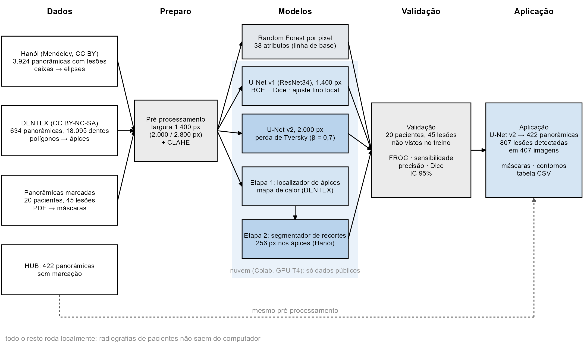
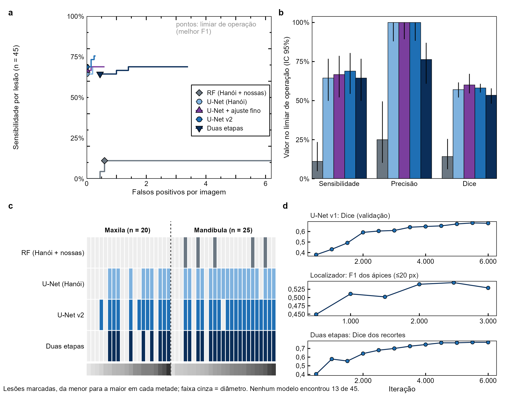

<div align="center">


# ML ODONTO

**Detecção de lesões periapicais em radiografias panorâmicas com poucos exemplos locais**

Redes neurais treinadas em dados públicos · revisão por especialistas · software local em R


</div>

---

## Sumário

- [Sobre o projeto](#sobre-o-projeto)
- [Principais resultados](#principais-resultados)
- [O software ML ODONTO](#o-software-ml-odonto)
- [Estrutura do repositório](#estrutura-do-repositório)
- [Instalação](#instalação)
- [Uso](#uso)
- [Pipeline de pesquisa (Python)](#pipeline-de-pesquisa-python)
- [Testes e reprodutibilidade](#testes-e-reprodutibilidade)
- [Dados, privacidade e ética](#dados-privacidade-e-ética)
- [Licença](#licença)

---

## Sobre o projeto

Lesões periapicais aparecem na radiografia panorâmica como áreas radiolúcidas pequenas e de contraste
baixo, e parte delas passa despercebida na leitura de rotina. Este projeto investiga se um detector
automático pode ser construído para o acervo de um serviço que dispõe de **apenas 20 panorâmicas com
lesões contornadas por especialista (45 lesões)** e de **422 panorâmicas sem marcação**.

Todos os modelos foram treinados apenas com **dados públicos** — 3.924 panorâmicas de Hanói com lesões
delimitadas por caixas e 705 panorâmicas do DENTEX — e avaliados nas radiografias locais, que nunca saem
do computador. Foram comparados:

| Abordagem | Ideia |
|---|---|
| Random Forest por pixel | 38 atributos de intensidade, textura e contexto (linha de base) |
| U-Net v1 | codificador ResNet34, 1.400 px, BCE + Dice |
| **U-Net v2** | 2.000 px, perda de Tversky (pesa mais a lesão perdida) — **modelo escolhido** |
| Duas etapas | localizador de ápices (DENTEX) + segmentação de recortes ampliados |
| Classificador por dente | um recorte por ápice, rótulos de Hanói e dos diagnósticos do DENTEX |

Para transformar o modelo em ferramenta de trabalho, o projeto inclui o **ML ODONTO**, um programa local
em R no qual o dentista revisa as detecções, audita as lesões não encontradas e acompanha os resultados.

<div align="center"></div>

## Principais resultados

Validação nas 20 panorâmicas marcadas (45 lesões; cada paciente avaliado por um modelo que não o viu):

| Modelo | Sensibilidade (≤ 0,5 FP/img) | Sensibilidade no limiar | Precisão | Dice |
|---|---|---|---|---|
| Random Forest (melhor) | 4% | 16% | 6% | 0,04 |
| U-Net v1 | 69% | 64% | 100% | 0,57 |
| **U-Net v2** | **76%** | **69%** (IC 95% 54–80%) | **100%** | 0,58 |
| Duas etapas | 64% | 64% | 76% | 0,53 |
| Classificador por dente | — | 56% (critério por ponto) | 54% | — |

- A U-Net v2 encontrou 31/45 lesões **sem nenhum falso positivo** e 34/45 com até 0,5 falso positivo por imagem.
- **13 das 45 lesões não foram encontradas por nenhum modelo**: são pequenas e, em sua maioria, maxilares. Os
  testes indicam que o limite é a representação desse tipo de lesão nos dados de treinamento, e não a
  arquitetura ou a resolução.
- Aplicada às 422 panorâmicas sem marcação, a U-Net v2 assinalou 807 lesões em 407 imagens; a precisão nesse
  acervo está sendo medida pela revisão especializada no próprio software.

<div align="center"></div>

## O software ML ODONTO

Programa local (Shiny + bslib) com aparência de ambiente de trabalho: painéis com abas e divisórias
arrastáveis, barra de ferramentas e barra de status. Roda em `127.0.0.1`, sem nenhuma chamada à internet.

| Tela | Para quê |
|---|---|
| **Início** | Fluxo de trabalho com os números atuais, painel "Ambiente" com as métricas, histórico de atividades |
| **Revisão** | Visualizador com zoom, contraste e modo cego; confirmar / rejeitar / dúvida (teclas 1/2/3); desenhar lesões não detectadas (M); amostra aleatória de 60 imagens para estimar o desempenho sem viés |
| **Auditoria** | Cada lesão de referência que o modelo não encontrou, ampliada, para o especialista julgar se é visível |
| **Resultados** | Curvas FROC, métricas com IC 95%, mapa de lesões por modelo, sensibilidade corrigida pela auditoria, concordância entre revisores (kappa) |
| **Aplicar** | Roda a U-Net v2 em novas radiografias, em segundo plano, com barra de progresso; as detecções vão direto para a revisão |
| **Ajuda** | Manual do dentista e atalhos |

A rede roda **em R** (pacote `torch`), sem Python: o pré-processamento (redução por área e CLAHE) e a
detecção foram reescritos e reproduzem o pipeline Python **lesão a lesão** nas 20 panorâmicas marcadas
(31/45, correlação das probabilidades ≥ 0,998). Detalhes em [`docs/EQUIVALENCIA_R_PYTHON.md`](docs/EQUIVALENCIA_R_PYTHON.md).

## Estrutura do repositório

```
ML-ODONTO/
├── README.md                     este arquivo
├── LICENSE                       uso acadêmico e não comercial
├── Abrir_ML_ODONTO.bat           abre o programa (Windows)
├── Revisar_lesoes.bat           ferramenta de revisão antiga (Python), substituída pelo ML ODONTO
│
├── software/                     ── programa ML ODONTO (R)
│   ├── instalar_dependencias.R   instala pacotes, libtorch e o programa
│   └── odontolesao/              pacote R
│       ├── R/                    módulos das telas (mod_*.R) e núcleo (fct_*.R)
│       ├── inst/app/www/         visor de radiografias (JS), estilos, logotipo
│       ├── inst/manuais/         manual do dentista (Markdown)
│       ├── inst/modelos/         registro dos modelos (pesos à parte, ver LEIAME.md)
│       ├── inst/sql/             migrações do banco SQLite
│       └── tests/                testes unitários e teste de equivalência R × Python
│
├── scripts/                      ── pipeline de pesquisa (Python)
│   ├── requirements.txt
│   ├── extrair_pdf.py            marcações do PDF → máscaras
│   ├── comum.py, unet.py, deteccao.py, apices.py, duas_etapas.py, dentes.py
│   ├── treinar.py, treino_unet.py, treino_duas_etapas.py, treino_dentes.py
│   ├── avaliar_unet.py, avaliar_duas_etapas.py, avaliar_dentes.py, comparar.py
│   ├── aplicar.py                aplicação em lote (versão Python)
│   ├── exportar_figuras.py, figuras_radiografias.py
│   └── gerar_notebook*.py        geram os notebooks do Colab a partir dos scripts
├── colab/                        notebooks de treino no Google Colab (GPU)
├── figuras_R/                    figuras quantitativas em R (estilo Nature)
├── docs/                         manual do dentista, plano do software, equivalência, imagens
├── Modelos/                      métricas e registros de treino (pesos fora do repositório)
├── Resultados/                   comparação e gráficos agregados (dados de pacientes fora)
├── Externos/                     conjuntos públicos (baixar da fonte, ver LEIAME.md)
└── .claude/skills/               guias de desenvolvimento do software (Claude Code)
```

Pastas **não versionadas** (dados de pacientes): `Dados/`, `HUB/`, `Treinamento/`, `Revisao/` (respostas),
partes de `Resultados/`. Veja [Dados, privacidade e ética](#dados-privacidade-e-ética).

## Instalação

**Requisitos:** Windows 10/11, [R 4.6](https://cran.r-project.org/bin/windows/base/), 8 GB de RAM (16 GB
recomendados para aplicar o modelo), ~2 GB livres em disco.

1. Clone o repositório:
   ```bash
   git clone https://github.com/williamjot/ML-ODONTO.git
   cd ML-ODONTO
   ```
2. Coloque os **pesos dos modelos** (`unet_lesoes_v2.safetensors` e demais, distribuídos à parte — veja
   [`software/odontolesao/inst/modelos/LEIAME.md`](software/odontolesao/inst/modelos/LEIAME.md)) em
   `software/odontolesao/inst/modelos/`.
3. Instale as dependências e o programa (uma vez; baixa ~200 MB do libtorch):
   ```bash
   Rscript software/instalar_dependencias.R
   ```
4. Abra com dois cliques em **`Abrir_ML_ODONTO.bat`** (ou `Rscript -e "odontolesao::run_app()"`).

Na primeira execução, o programa importa as radiografias e as detecções da pasta do projeto (opção
`odontolesao.projeto`) e guarda tudo em `Documentos\OdontoLesao` — banco SQLite, cópias reduzidas das
imagens e backups diários.

## Uso

- **Dentistas:** leia o [**Manual do dentista**](docs/MANUAL_DENTISTA.md) (também disponível no programa, aba
  Ajuda). Em resumo: revise primeiro as 60 imagens da amostra aleatória, use **H** para olhar sem as
  marcações, decida cada detecção com **1/2/3** e desenhe com **M** as lesões que o programa não marcou.
- **Pesquisadores:** a tela **Resultados** mostra as métricas atualizadas a cada revisão; os gráficos podem
  ser baixados em PNG. O plano completo do software está em [`docs/PLANO_SOFTWARE.md`](docs/PLANO_SOFTWARE.md).

## Pipeline de pesquisa (Python)

```bash
pip install -r scripts/requirements.txt
```

| Etapa | Script | Observação |
|---|---|---|
| Marcações do PDF → máscaras | `extrair_pdf.py` | 45 lesões em 20 pacientes |
| Random Forest por pixel | `treinar.py` | linha de base, CPU |
| U-Net v1 / v2 | `treino_unet.py` (via `colab/Treino_UNet*_Lesoes.ipynb`) | GPU no Google Colab, só dados públicos |
| Duas etapas | `treino_duas_etapas.py` (via `colab/Treino_Duas_Etapas.ipynb`) | localizador de ápices + recortes |
| Classificador por dente | `treino_dentes.py` (via `colab/Treino_Classificador_Dentes.ipynb`) | Hanói + diagnósticos do DENTEX |
| Avaliação local | `avaliar_unet.py`, `avaliar_duas_etapas.py`, `avaliar_dentes.py`, `comparar.py` | nas 20 panorâmicas marcadas |
| Figuras | `exportar_figuras.py` → `figuras_R/*.R`; `figuras_radiografias.py` | gráficos em R, figuras com radiografias em Python |

Os notebooks do Colab são **gerados** pelos `gerar_notebook*.py`, que embutem o código de `scripts/`,
garantindo que o treino na nuvem use exatamente o mesmo código. Conjuntos externos: veja
[`Externos/LEIAME.md`](Externos/LEIAME.md).

## Testes e reprodutibilidade

```bash
# testes unitários do pacote (29 testes)
Rscript -e "testthat::test_local('software/odontolesao')"

# equivalência R × Python nas 20 panorâmicas marcadas (~10 min; exige os dados locais)
Rscript software/odontolesao/tests/equivalencia.R
```

## Dados, privacidade e ética

- As radiografias de pacientes **nunca** são enviadas à nuvem: só os conjuntos públicos vão ao Colab; a
  avaliação, a aplicação e a revisão rodam no computador local.
- Nada que identifique pacientes é versionado (veja o `.gitignore`). Gráficos e relatórios usam
  identificadores anônimos (A001…, 01–20).
- Conjuntos públicos: **Hanói** — Panoramic radiographs with periapical lesions, Mendeley Data v3,
  [doi:10.17632/kx52tk2ddj.3](https://doi.org/10.17632/kx52tk2ddj.3) (CC BY 4.0); **DENTEX** — Hamamci et al.,
  arXiv:2305.19112 (CC BY-NC-SA 4.0).
- O software apoia a revisão por especialistas e **não substitui o diagnóstico clínico**.

## Licença

Uso acadêmico e não comercial — veja [`LICENSE`](LICENSE). Modelos derivados do DENTEX seguem a licença
CC BY-NC-SA 4.0.

---

<div align="center">
<sub>William Jota · Laboratório de Estudos Eletromagnéticos (LEMAG) · Universidade de Brasília</sub>
</div>
